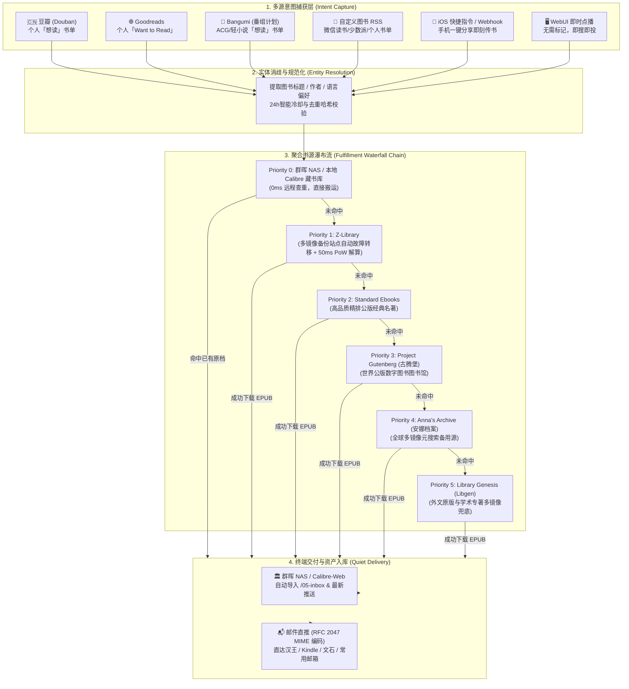

# 📖 ReadFlow

> **Universal Zero-UI Book Acquisition & Delivery Engine**  
> *在豆瓣或 Goodreads 随手点「想读」，电子书自动多源搜寻、入库群晖 NAS / Calibre 并秒级送达你的电纸书与邮箱！*

<p align="center">
  
  
  
  
  
</p>

---

## 💡 为什么需要 ReadFlow？

传统的找书与传书体验繁琐且充满摩擦力：
```text
手机刷到好书 ➔ 复制书名 ➔ 打开网页搜索资源 ➔ 鉴别真伪与广告弹窗 ➔ 下载 EPUB ➔ 找数据线/网盘/传输网页 ➔ 导入电纸书 ➔ 手动整理书架
```
**在这个跨越 7 个环节、多台设备的过程中，绝大多数阅读兴趣都被繁琐的操作消磨殆尽。**

### ReadFlow 的第一性原理（First Principles）：
1. **零摩擦意图捕捉（Zero-UI Intent Capture）**：人在做决策的一瞬间动作最自然。手机豆瓣随手点击「想读」，或在 Goodreads 随手标记「Want to Read」，流程即刻全自动触发。
2. **静默软件哲学（Quiet Software）**：无需机器人繁琐汇报，不打扰你的专注。**当你拿起电纸书（汉王/Kindle/文石）或打开邮箱看到推送时，书已经静静躺在你的原生书架上了**。
3. **双重安全网资产闭环**：
   * **资产终身归档**：新书自动录入群晖 NAS / Calibre，永久保存原生元数据，防网络失效与平台下架。
   * **最后一公里直达**：利用 RFC 2047 兼容编码邮件自动推送，电纸书开机即读。

---

## 🏗️ 架构流向图



---

## ✨ 核心特性

- 📱 **6 大意图捕获来源**：
  * 原生适配 **豆瓣想读**、**Goodreads Want-to-Read**、**Bangumi 番组计划**、**自定义图书 RSS 订阅流**（如微信读书书架）、**iOS 快捷指令/Webhook 接口** 以及 **WebUI 即时找书**。
- 🔄 **Z-Library 多镜像站点故障自动转移**：
  * 支持配置主域名与备份站点池（`z-lib.gs`、`z-library.do`、`z-lib.is`、`singlelogin.re` 等），主站遭遇限速、超时或 DNS 污染时，毫秒级无缝自动切换备份镜像。
  * 内置针对新版反爬挑战的纯 Python 快速 SHA-1 PoW 算力解算器（50ms 极速通过）。
- 📚 **全网 6 级瀑布流检索矩阵**：
  * 私有 Calibre 库 ➔ Z-Lib (多镜像) ➔ Standard Ebooks ➔ Project Gutenberg ➔ Anna's Archive (多镜像) ➔ Library Genesis (多镜像)。公版名著、畅销通俗、专业冷门专著层层兜底。
- 🏛️ **群晖 NAS / Calibre 深度闭环**：
  * 支持远程 SSH 直查群晖 NAS 上的 `metadata.db`，已有图书直接搬运至推送区，零网络带宽浪费。
  * 自动将新获取图书移入 Calibre-Web 监控的 `/05-inbox` 目录，全自动完成数字资产入库。
- 📬 **国内邮箱附件 100% 兼容（告别 noname）**：
  * 严格遵循 **RFC 2047 MIME Base64 规范** 对中文附件名进行双重编码，完美兼容网易 163、QQ 邮箱、Gmail、Outlook 等，在汉王、Kindle、文石设备上直接显示完整中文书名并自动上架。
- 📦 **大附件智能防爆降级**：
  * 单本图书体积超过 25MB 时，自动截断避免邮件退信，图书安全归入 NAS 书库并向设备发送纯文本提醒。
- 🖥️ **Apple 风格极简 Web 控制中心（WebUI）**：
  * **Bento Grid 仪表盘**：实时查看守护状态、即时任务步骤与呼吸灯、藏书量全景统计。
  * **图书账本**：全量历史检索，支持快捷键 `/` 瞬时过滤。
  * **即时找书**：临时想看无需去豆瓣打标记，在网页直接搜书直达。
  * **配置中心**：全字段可视化热更新，采用原子写入保障配置安全。
  * **内置终端日志**：实时滚动查看守护日志。

---

## 🖥️ Web 控制中心一览

运行服务后，访问 `http://localhost:8765` 即可打开控制中心：

* **实时概览**：动态呼吸脉冲、正在巡检/解密/投递进度、多渠道命中占比统计。
* **图书账本**：完整记录每本图书的来源、格式、体积、命中渠道及收件邮箱。
* **即时找书**：一键输入书名与作者，后台自动走瀑布流搜寻并投递。
* **配置管理**：豆瓣、Goodreads、邮箱、群晖 NAS、Z-Lib 凭据可视化编辑，即时热生效。
* **运行日志**：黑底原生暗黑终端风格，最近执行明细实时排查。

---

## 🚀 详细安装与部署指南

### 前置准备
1. **Python 环境**：Python 3.10 及以上（若使用 Docker 或群晖套件，直接一键安装即可）。
2. **发信邮箱**：准备一个支持 SMTP 的邮箱（如网易 163 授权码、QQ 邮箱授权码、Gmail 应用专用密码）。
3. **电纸书收件邮箱**：汉王电纸书投递邮箱、Kindle 个人文档邮箱、或常用接收邮箱。

---

### 🤖 方式一：AI 编程助手一键全自动安装（最快最省心，强烈推荐！）

如果你正在使用 **Cursor、Claude Code、Windsurf、Cline、GitHub Copilot CLI 或任意支持终端执行的本地 AI Agent**，无需逐行敲命令！直接**复制下方这串提示词发给你的 AI 助手**，AI 将自动探测你的操作系统、拉取代码、构建虚拟环境、引导配置并启动守护进程：

> 💡 完整独立提示词文档亦可查阅：[docs/AI_INSTALL_PROMPT.md](docs/AI_INSTALL_PROMPT.md)

````markdown
请帮我在当前机器上全自动安装并常驻运行 ReadFlow（https://github.com/P-bit-display/readflow.git）：
1. 检测当前操作系统与环境（macOS / Linux / Windows / 群晖）。
2. 克隆代码仓库并建立 Python 虚拟环境，安装依赖 `requirements.txt`。
3. 询问并引导我配置 3 个核心参数（豆瓣数字 ID、电纸书接收邮箱、发信 SMTP 密码），原子化生成 `.env`。
4. 根据当前系统配置自启动守护进程（macOS 使用 LaunchAgent，Linux 使用 systemd，或 Docker 容器）。
5. 启动后检查 `http://localhost:8765/api/status` 确认服务存活，并向我展示 WebUI 链接。
````

---

### 🏛️ 方式二：群晖 NAS 原生套件安装（SPK 一键安装包）

专为群晖用户设计，**无需使用 Docker 或敲击 SSH 命令行**，支持 DSM 7.x 与 DSM 6.x：

> 💡 详见群晖套件专题文档：[docs/SYNOLOGY_INSTALL.md](docs/SYNOLOGY_INSTALL.md)

1. **准备 Python**：在群晖 **套件中心** 搜索安装官方 **Python 3** 套件。
2. **安装套件**：
   * 从 Releases 或 `dist/` 下载 `readflow_1.0.0_noarch.spk`。
   * 打开群晖 **套件中心** ➔ 点击右上角 **「手动安装」** ➔ 上传 `readflow_1.0.0_noarch.spk`。
   * 按照弹出的图形化安装向导，输入你的豆瓣 ID、Goodreads ID 与接收邮箱。
3. **桌面图标直达**：
   * 安装完成后，群晖 DSM 桌面与主菜单将自动生成 **ReadFlow** 专属图标。
   * 点击图标直接打开 Web 控制中心（默认端口 `8765`），支持在套件中心直接启停与看日志。

---

### 🐳 方式三：Docker Compose 部署（NAS / 云服务器推荐）

1. **克隆代码库**：
   ```bash
   git clone https://github.com/P-bit-display/readflow.git
   cd readflow
   ```

2. **配置环境变量**：
   ```bash
   cp .env.example .env
   vim .env
   ```
   *填入你的豆瓣 ID、Goodreads ID、发信邮箱授权码与收件邮箱（详细配置说明见后文）。*

3. **启动容器**：
   ```bash
   docker compose up -d
   ```

4. **查看运行状态**：
   ```bash
   docker compose logs -f
   ```
   打开浏览器访问 `http://<你的NAS或服务器IP>:8765` 进入控制中心。

---

### 🍏 方式四：macOS 本地常驻服务（LaunchAgent 推荐）

适合放在 Mac mini、MacBook 或家庭常开的 Mac 电脑上静默运行：

1. **克隆并安装依赖**：
   ```bash
   git clone https://github.com/P-bit-display/readflow.git
   cd readflow
   python3 -m venv venv
   source venv/bin/activate
   pip install -r requirements.txt
   ```

2. **生成配置文件**：
   ```bash
   cp .env.example .env
   # 编辑填入个人配置
   vim .env
   ```

3. **配置 macOS LaunchAgent 守护进程**：
   创建 `~/Library/LaunchAgents/com.user.readflow.plist` 文件：
   ```xml
   <?xml version="1.0" encoding="UTF-8"?>
   <!DOCTYPE plist PUBLIC "-//Apple//DTD PLIST 1.0//EN" "http://www.apple.com/DTDs/PropertyList-1.0.dtd">
   <plist version="1.0">
   <dict>
       <key>Label</key>
       <string>com.user.readflow</string>
       <key>ProgramArguments</key>
       <array>
           <string>/path/to/readflow/venv/bin/python</string>
           <string>-u</string>
           <string>/path/to/readflow/main.py</string>
       </array>
       <key>WorkingDirectory</key>
       <string>/path/to/readflow</string>
       <key>RunAtLoad</key>
       <true/>
       <key>KeepAlive</key>
       <true/>
       <key>StandardOutPath</key>
       <string>/Users/your_username/.readflow/logs/readflow.log</string>
       <key>StandardErrorPath</key>
       <string>/Users/your_username/.readflow/logs/readflow.error.log</string>
   </dict>
   </plist>
   ```

4. **加载并运行服务**：
   ```bash
   launchctl load ~/Library/LaunchAgents/com.user.readflow.plist
   ```
   此时服务已在后台静默启动，开机自启，并自动开放 `http://localhost:8765`。

---

### 🐧 方式五：Linux systemd 守护服务部署

适合 Ubuntu / Debian / CentOS 主机：

1. **创建服务单元文件** `/etc/systemd/system/readflow.service`：
   ```ini
   [Unit]
   Description=ReadFlow Quiet Book Engine
   After=network.target

   [Service]
   Type=simple
   User=your_user
   WorkingDirectory=/opt/readflow
   ExecStart=/opt/readflow/venv/bin/python -u /opt/readflow/main.py
   Restart=always
   RestartSec=10
   Environment=PYTHONUNBUFFERED=1

   [Install]
   WantedBy=multi-user.target
   ```

2. **启动与开机自启**：
   ```bash
   sudo systemctl daemon-reload
   sudo systemctl enable --now readflow
   sudo systemctl status readflow
   ```

---

## ⚙️ 配置文件参数详解 (`.env`)

| 参数项 | 说明 | 示例 / 默认值 | 必填 |
| :--- | :--- | :--- | :---: |
| **`DOUBAN_USER_ID`** | 豆瓣用户数字 ID 或个性域名后缀 | `your_douban_id` | 选填 |
| **`GOODREADS_USER_ID`** | Goodreads 用户数字 ID | `your_goodreads_id` | 选填 |
| **`CHECK_INTERVAL_SECONDS`**| 巡查想读动态的周期（秒） | `600` (10分钟) | 否 |
| **`SMTP_SERVER`** | 发信 SMTP 服务器地址 | `smtp.gmail.com` 或 `smtp.163.com` | 是 |
| **`SMTP_PORT`** | 发信 SMTP 端口 | `465` (SSL) 或 `587` (TLS) | 是 |
| **`SMTP_USER`** | 发信邮箱账号 | `your_account@gmail.com` | 是 |
| **`SMTP_PASSWORD`** | 邮箱授权码/应用专用密码（非登录密码） | `xxxx-xxxx-xxxx-xxxx` | 是 |
| **`TARGET_EMAIL`** | 接收电子书的邮箱（电纸书/个人邮箱） | `your_reader@163.com` | 是 |
| **`NAS_SSH_HOST`** | 远程群晖 NAS 的 SSH 别名（如免密登录别名） | `nas` | 否 |
| **`NAS_CALIBRE_ROOT`** | NAS 或本地 Calibre 书库物理根路径 | `/volume1/homes/user/Books/Calibre` | 否 |
| **`NAS_CALIBRE_DB`** | Calibre `metadata.db` SQLite 数据库路径 | `/volume1/homes/user/Books/Calibre/metadata.db` | 否 |
| **`NAS_INBOX_DIR`** | Calibre-Web 自动入库监视收件箱 | `/volume1/homes/user/Books/05-inbox` | 否 |
| **`ZLIB_EMAIL`** | Z-Library 账号邮箱 | `your_zlib@outlook.com` | 建议 |
| **`ZLIB_PASSWORD`** | Z-Library 账号密码 | `your_zlib_password` | 建议 |
| **`ZLIB_DOMAIN`** | Z-Library 可访问的主镜像或第三方镜像 | `z-library.sk` | 否 |
| **`HTTP_PROXY`** | 本地网络代理（如 Clash / V2Ray） | `http://127.0.0.1:7897` | 否 |
| **`ENABLE_ANNAS_ARCHIVE`**| 是否启用安娜档案（Anna's Archive）免登备选源 | `true` | 否 |
| **`ENABLE_LIBGEN`** | 是否启用 Library Genesis 学术兜底源 | `true` | 否 |

---

## ❓ 常见问题排查 (FAQ)

### Q1: 汉王或网易 163 邮箱收到附件变成了 `noname` 或 `winmail.dat`？
* **A**: 这是传统发信脚本使用不合规的邮件标头（Header）导致的。ReadFlow 采用 **RFC 2047 双重 Base64 编码**规范，附件名称强制以 `utf-8` 标注，彻底解决了汉王电纸书（N10、N10 Pro）、网易 163 邮箱以及 QQ 邮箱将中文字符附件解析为 `noname` 的顽疾。

### Q2: 为什么不用 Telegram Bot 发书，而坚持邮件直推？
* **A**: 
  1. Telegram Bot 发送的书籍往往需要手动保存到手机，再通过数据线或第三方传书网页上传电纸书，割裂感严重；
  2. 邮件推送是电纸书（Kindle / 汉王 / 文石）原生支持的最优雅无感通道，设备连上 Wi-Fi 即可自动收件并完成封面排版上架，实现真正的 **Zero-UI 隐形交付**。

### Q3: 频繁检查会触发豆瓣反爬虫吗？
* **A**: 不会。ReadFlow 默认采用 10 分钟（600秒）保守轮询周期，且仅对个人的公开想读书单发起单次 HTTP GET 请求，附带标准浏览器 User-Agent，不会对豆瓣服务器造成任何压力，生产环境稳定运行验证无阻断。

### Q4: 下载的书籍大于 25MB 无法通过邮件附件发送怎么办？
* **A**: ReadFlow 内置大附件防爆熔断保护。一旦体积超过 24MB，程序会自动截断邮件附件投递，避免邮件服务器退信；同时直接将该 EPUB 归档存入群晖 NAS 书库，并向你的邮箱发送一封友好通知，提醒你该书已入库。

---

## 📄 免责声明 (Disclaimer)

本项目仅供个人学术研究、自动化技术学习及自建家庭媒体库探索交流使用。所有网络检索逻辑均基于第三方开放接口与用户个人合法账户。请尊重知识产权，支持正版图书出版物。

---

## 📜 开源许可证 (License)

本项目基于 [MIT License](LICENSE) 开源。欢迎提交 Pull Request 和 Issue！
